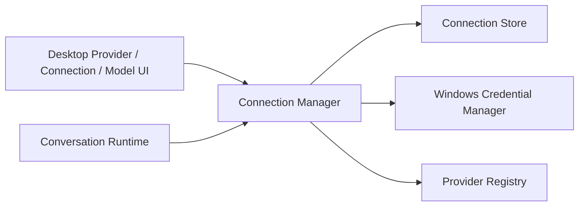
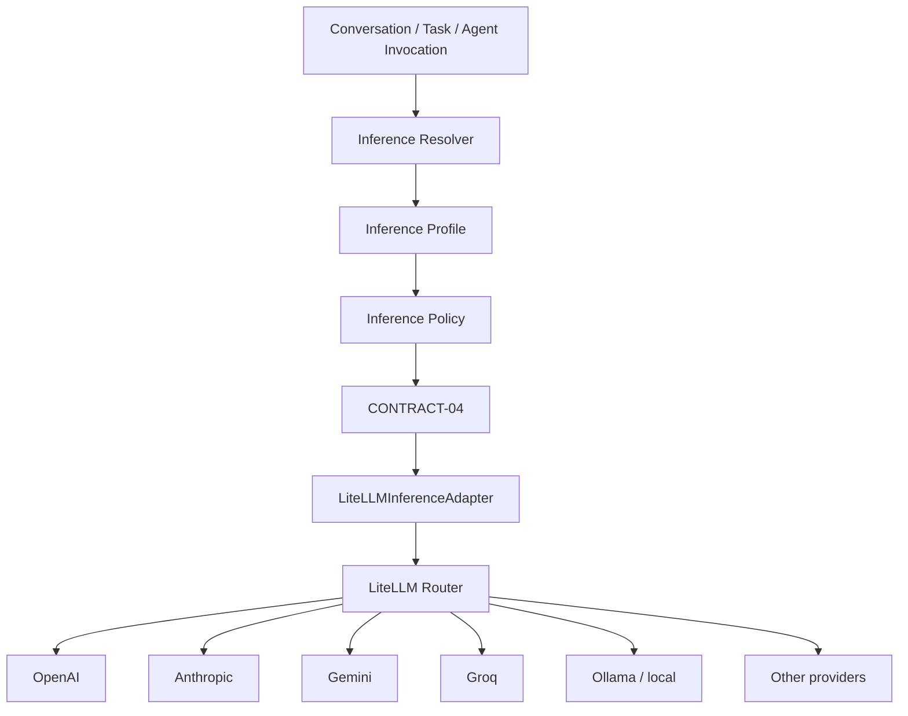
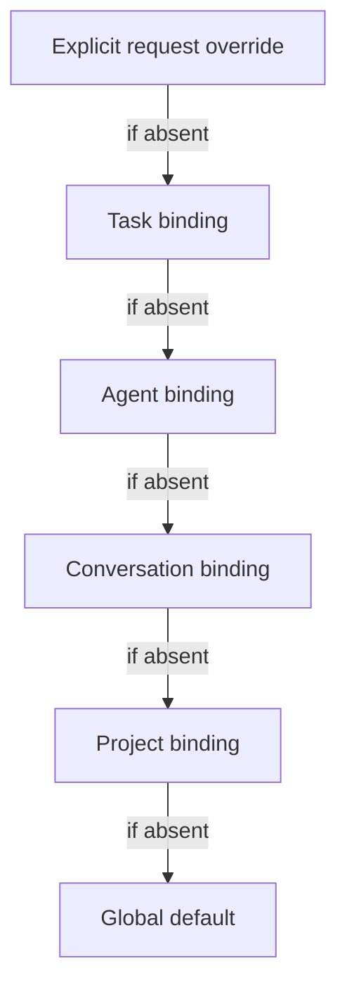
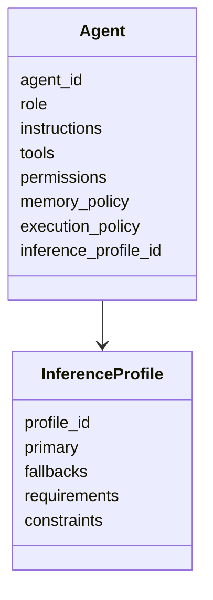
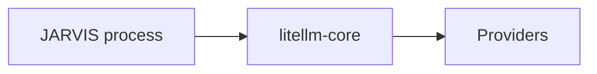
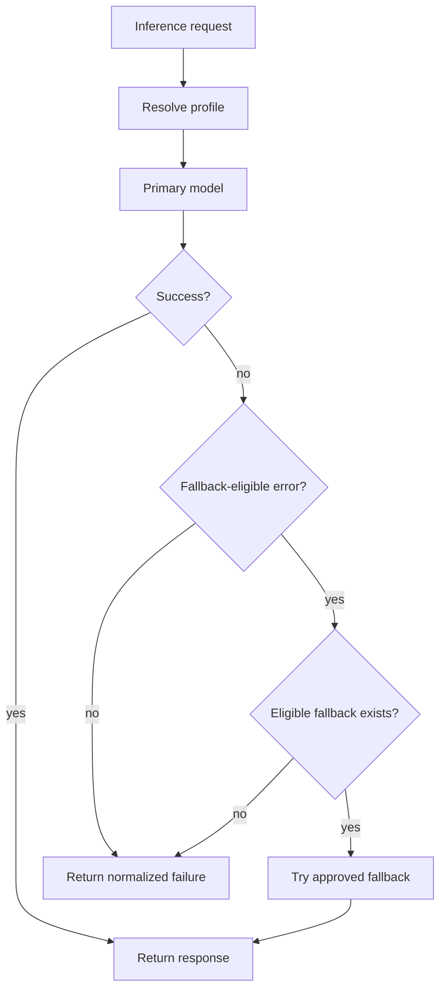
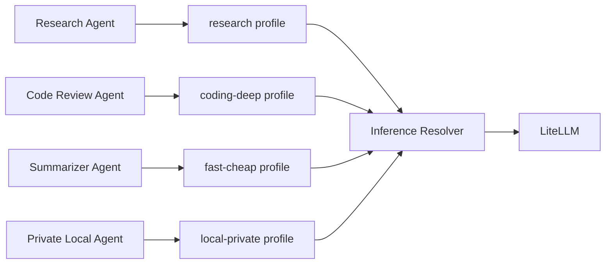

# JARVIS — TB-04 LiteLLM Inference Architecture Transition SPEC

**Status:** APPROVED — IMPLEMENTATION STARTED  
**Date:** 2026-11-02  
**Branch:** `feat/tb-04-providers-connections`  
**Scope:** TB-04 — AI Providers, Connections, Model Selection and Future Fallback  
**Baseline:** CONTRACT-04, CONTRACT-06, CONTRACT-07, ARCH-06 and the already validated OpenAI/Anthropic rotation.

---

## 1. Purpose

Replace the current **one native inference adapter per LLM provider** strategy with a scalable provider abstraction based on **LiteLLM**, while keeping JARVIS ownership of:

- Conversation and context;
- Connection lifecycle and secrets;
- model/provider selection policy;
- project/task/agent inference preferences;
- capability requirements;
- privacy and budget constraints;
- fallback eligibility;
- authority, confirmations and execution policy.

LiteLLM becomes a **provider compatibility and routing mechanism**, not the owner of JARVIS orchestration or authority.

This is a controlled architectural transition, not a destructive rollback.

---

## 2. Decision summary

### Keep

- `CONTRACT-04` as the JARVIS inference boundary;
- `ConnectionManager` / Connection Store;
- Windows Credential Manager secrets;
- explicit Provider Registry;
- Provider / Connection / Model desktop concepts;
- Conversation continuity independent from provider;
- OpenAI + Anthropic real validation evidence;
- GitHub external integration foundation;
- Voice Runtime / CONTRACT-05 independent from LLM routing.

### Replace as primary path

Current:

```text
CONTRACT-04
   ├── OpenAIResponsesAdapter
   ├── AnthropicMessagesAdapter
   ├── GeminiAdapter         (would be next)
   ├── GroqAdapter
   └── ...
```

Target:

```text
CONTRACT-04
      │
      ▼
LiteLLMInferenceAdapter
      │
      ▼
LiteLLM Core / Router
      ├── OpenAI
      ├── Anthropic
      ├── Gemini
      ├── Groq
      ├── Mistral
      ├── Bedrock
      ├── Ollama
      ├── OpenRouter
      └── 100+ providers
```

Native provider adapters remain only as a temporary migration safety net or a future exceptional escape hatch when a provider capability cannot be represented correctly by LiteLLM.

---

## 3. What is *not* being rolled back

The following TB-04 work is retained:



The transition changes only the **inference transport/compatibility layer** below CONTRACT-04.

---

## 4. Target architecture



JARVIS determines **what may be used and why**. LiteLLM determines **how to call the selected provider/model and perform permitted technical routing**.

---

## 5. Core domain concepts

### 5.1 AIProviderConnection

Represents access to a provider/account.

Examples:

```text
OpenAI principal
Anthropic pessoal
Gemini workspace
Ollama local
OpenRouter principal
```

Conceptual fields:

```text
connection_id
provider_id
display_name
credential_ref
enabled
availability
observed_capabilities
observed_models
last_verified_at
```

Secrets remain outside SQLite.

A Connection does **not** define which task or agent should use it.

---

### 5.2 ModelRef

A provider-qualified model reference.

Examples:

```text
openai/gpt-6-luna
anthropic/claude-sonnet-5-5
gemini/gemini-...
ollama/qwen...
```

Conceptually:

```text
connection_id
litellm_model
capabilities
cost_metadata
context_metadata
locality
```

The model reference never contains a raw secret.

---

### 5.3 InferenceProfile

Stable JARVIS-owned policy that points to one primary model and optional alternatives.

Example:

```yaml
id: general
primary:
  connection: openai-principal
  model: openai/gpt-6-luna

fallbacks:
  - connection: anthropic-principal
    model: anthropic/claude-sonnet-5-5

requires:
  streaming: true
  structured_output: true

constraints:
  locality: cloud_allowed
  max_cost: null
  fallback_enabled: false
```

Another profile:

```yaml
id: coding-deep
primary:
  connection: anthropic-principal
  model: anthropic/claude-sonnet-5-5

fallbacks:
  - connection: openai-principal
    model: openai/gpt-6-luna

requires:
  streaming: true
  structured_output: true
  tool_calling: true

constraints:
  locality: cloud_allowed
```

An Agent, Project or Task should point to an `InferenceProfile`, not directly to a physical model whenever long-lived configuration is intended.

---

### 5.4 InferenceBinding

Associates a scope with a profile.

Conceptually:

```text
scope_type:
  global
  project
  conversation
  agent
  task

scope_id
profile_id
enabled
```

This is what makes the model policy composable without embedding provider names into agents.

---

### 5.5 InferenceRequest

Canonical request produced by JARVIS before LiteLLM is involved.

Conceptually:

```text
conversation_id
task_id?
agent_id?
project_id?
purpose
messages
requirements
privacy_constraints
budget_constraints
streaming_required
structured_output_schema?
correlation_id
```

The request contains policy-relevant information, not provider-specific syntax.

---

### 5.6 ResolvedInferencePlan

Output of `InferenceResolver`.

Example:

```yaml
profile: coding-deep
selected_from: agent

primary:
  connection_id: anthropic-principal
  model: anthropic/claude-sonnet-5-5

fallbacks:
  - connection_id: openai-principal
    model: openai/gpt-6-luna

effective_requirements:
  streaming: true
  structured_output: true

effective_constraints:
  cloud_allowed: true

fallback_policy:
  enabled: false
```

The plan should preserve **provenance**: JARVIS can explain why that model was selected.

---

## 6. Selection precedence

Long-lived model selection is resolved using:



Precedence:

```text
1. Explicit request override
2. Task profile
3. Agent profile
4. Conversation profile
5. Project profile
6. Global default profile
```

A more specific scope wins.

### Examples

Normal chat:

```text
Conversation profile → general
```

Inside project `sofias_memory`:

```text
Project profile → reasoning-high
```

Agent execution:

```text
Agent: code-reviewer
InferenceProfile: coding-deep
```

A single expensive task inside that agent:

```text
Task override → reasoning-max
```

No Agent object needs to be rewritten when the physical model changes later.

---

## 7. Agent architecture impact

Future Agent:



Agents do not own provider API keys.

Agents do not directly instantiate LiteLLM.

Agents request inference through JARVIS Core.

Example:

```text
Research Agent       → profile: research
Code Review Agent    → profile: coding-deep
Summarizer Agent     → profile: fast-cheap
Private Agent        → profile: local-private
```

All may run simultaneously using different providers/models.

---

## 8. Project and Task examples

```text
Global default
└── general
    └── OpenAI

Project: Sofias Memory
└── reasoning-high
    └── Anthropic

Project: e-burguer
└── fast-balanced
    └── Gemini

Agent: code-reviewer
└── coding-deep
    └── Anthropic

Task: summarize 500 notifications
└── fast-cheap
    └── Groq

Task: sensitive local document review
└── local-private
    └── Ollama
```

The same Conversation/Task infrastructure remains canonical regardless of provider.

---

## 9. LiteLLM responsibility boundary

LiteLLM may own:

- provider request translation;
- provider response normalization;
- streaming normalization;
- provider error mapping;
- model metadata support;
- retries permitted by JARVIS policy;
- fallbacks permitted by JARVIS policy;
- load balancing when explicitly configured;
- cost/usage observations when available.

JARVIS continues to own:

- profile resolution;
- provider connection selection;
- credentials lifecycle;
- capability admission;
- privacy policy;
- cost policy;
- authority;
- confirmations;
- execution effects;
- Memory;
- Knowledge;
- Agent identity;
- Task lifecycle;
- audit and recovery semantics.

---

## 10. LiteLLM deployment mode

### TB-04 / desktop MVP

Use **`litellm-core` in-process**.



No additional server, PostgreSQL or Redis is introduced.

Reasons:

- local-first architecture;
- lower operational complexity;
- no need for a network hop;
- SDK already provides provider translation, Router, retries/fallbacks and model metadata;
- easier migration from current native adapters.

### Future distributed/multi-user deployment

LiteLLM Gateway may later become appropriate:

```text
JARVIS clients / agents
        ↓
LiteLLM Gateway
        ↓
provider pool
```

Potential reasons:

- shared budgets;
- virtual keys;
- organization-wide rate limits;
- centralized cost accounting;
- distributed agents;
- multiple JARVIS instances.

Gateway is **not approved as an MVP runtime dependency by this SPEC**.

---

## 11. Secret handling

JARVIS remains the credential authority for desktop connections.

```text
Windows Credential Manager
        ↓
Connection Manager
        ↓
ResolvedInferencePlan
        ↓
LiteLLM call
```

Requirements:

- never store raw provider secrets in SQLite;
- never expose raw provider secrets to Vue;
- avoid process-global provider environment variables for normal multi-connection use;
- credential should be supplied for the selected connection/request;
- two accounts of the same provider must remain isolated.

LiteLLM does not replace the JARVIS Connection Manager.

---

## 12. Provider Registry after LiteLLM

The registry no longer means “one Python adapter class per provider”.

It becomes provider metadata and eligibility information.

Example:

```yaml
provider_id: anthropic
transport: litellm
litellm_prefix: anthropic
auth_method: api_key
provider_type: ai_inference
supports_multiple_connections: true
```

A new provider should normally be onboarded by configuration/metadata, not code.

### Architectural proof

After migration, adding a third provider such as Gemini should **not** require:

```text
GeminiAdapter.py
```

Expected path:

```text
register provider metadata
→ configure credential
→ choose LiteLLM model
→ validate capability
→ use in existing Conversation
```

If a new ordinary chat provider requires a new JARVIS adapter, the migration has not achieved its goal.

---

## 13. Capability awareness

Provider normalization does not imply universal capability equivalence.

JARVIS keeps its own capability requirements.

Conceptual capability set:

```text
text
streaming
structured_output
tool_calling
vision
audio_input
reasoning
embeddings
context_window
max_output
locality
usage_reporting
cost_reporting
```

Profile example:

```yaml
requires:
  streaming: true
  structured_output: true
  tool_calling: true
```

The resolver must exclude models that cannot satisfy the requirements.

LiteLLM model metadata may be used as evidence, but JARVIS still owns the eligibility decision.

---

## 14. Structured output

The canonical JSON Schema belongs to JARVIS.

Current provider-specific transformations such as the Anthropic nullable-enum workaround should **not** leak into the Core.

Target:

```text
JARVIS canonical schema
        ↓
LiteLLMInferenceAdapter
        ↓
LiteLLM provider normalization
        ↓
provider
```

If LiteLLM still exposes a provider-specific incompatibility, the workaround belongs in the **single LiteLLM adapter compatibility layer**, not in Conversation/Agent/Task code.

---

## 15. Fallback policy

LiteLLM supports fallbacks technically. JARVIS decides when fallback is allowed.

### Default fallback-eligible failures

Candidates:

```text
PROVIDER_TIMEOUT
PROVIDER_UNAVAILABLE
RATE_LIMITED
temporary deployment failure
```

### Default non-fallback failures

```text
AUTHENTICATION_FAILED
PERMISSION_INSUFFICIENT
BILLING_UNAVAILABLE
PROVIDER_REQUEST_INVALID
invalid structured schema
JARVIS policy denial
safety refusal
authority/confirmation denial
protected-operation rejection
```

Fallback must never be used as a way to bypass:

- JARVIS authorization;
- provider/account privacy constraints;
- an explicit safety decision;
- cost limits;
- locality requirements;
- missing tool/capability requirements.

A fallback plan must remain inside the effective `InferenceProfile`.

---

## 16. Fallback flow



No fallback changes authority or side-effect policy.

---

## 17. LangChain position

LangChain is **not** selected as the provider compatibility layer in this SPEC.

Reason:

JARVIS already owns Conversation, Tasks, Agents, Memory, authority, execution and recovery. Making LangChain the central runtime now risks creating overlapping orchestration semantics.

Potential future position:

```text
JARVIS Agent Runtime
       │
       ├── native planning/orchestration
       └── optional LangChain/LangGraph workflow integration
                    │
                    ▼
             JARVIS Inference Port
                    │
                    ▼
                 LiteLLM
```

If LangChain/LangGraph is introduced later:

- it must not bypass CONTRACT-04;
- it must not own provider secrets;
- `with_fallbacks()` must not bypass JARVIS fallback policy;
- it must not become authority for protected effects.

---

## 18. Migration strategy

This is a controlled replacement with rollback safety.

### Phase A — Freeze current validated baseline

Current native path remains functional:

```text
OpenAI native adapter
Anthropic native adapter
```

No new native LLM provider adapter is added.

### Phase B — Add LiteLLM path in parallel

```text
CONTRACT-04
   ├── Native path       (baseline)
   └── LiteLLM path      (candidate)
```

Run parity tests against the same OpenAI and Anthropic connections.

### Phase C — Feature-gated default switch

```text
JARVIS_INFERENCE_BACKEND=litellm
```

becomes the candidate default.

Native path remains available only as temporary rollback during validation.

### Phase D — Product acceptance

Required:

- OpenAI same-Conversation parity;
- Anthropic same-Conversation parity;
- structured intent routing parity;
- streaming parity;
- Memory/Knowledge parity;
- model/provider selection parity;
- voice remains unaffected;
- no secret regression.

### Phase E — Remove native LLM adapter dependency from primary runtime

After acceptance:

- remove `AnthropicMessagesAdapter` from primary runtime;
- remove direct Anthropic SDK dependency if nothing else requires it;
- OpenAI SDK may remain for CONTRACT-05 STT until Voice is separately generalized;
- native inference adapter code may be deleted or retained temporarily as explicitly marked fallback/reference, but must not remain the normal production path.

### Phase F — Prove scale with third provider

Add Gemini (or another selected provider) **without creating a provider-specific JARVIS inference adapter**.

This is the architectural proof of success.

---

## 19. InferenceProfile rollout

Profiles should be introduced after LiteLLM parity, not simultaneously with the transport migration.

Recommended sequence:

```text
1. LiteLLM parity for current manual Provider/Connection/Model
2. InferenceProfile data model
3. Global profile
4. Conversation binding
5. Project binding
6. Agent binding
7. Task binding
8. Explicit request override
9. capability-aware fallback
10. budget/cost-aware policies
```

This prevents provider migration and policy redesign from becoming one untestable change.

---

## 20. UI evolution

### Current TB-04 UI

```text
Provider   [ Anthropic            ]
Connection [ Claude principal     ]
Model      [ claude-sonnet-5-5    ]
```

This stays useful as an explicit/manual override.

### Later profile-aware UI

```text
Inference Profile [ coding-deep ▼ ]

Resolved:
Provider   Anthropic
Connection Claude principal
Model      claude-sonnet-5-5

Fallback:
OpenAI principal / gpt-6-luna
```

Advanced/manual override remains available for debugging and deliberate owner control.

---

## 21. Example: multiple agents



Possible simultaneous resolutions:

```text
Research Agent     → Gemini
Code Review Agent  → Anthropic
Summarizer Agent   → Groq
Private Agent      → Ollama
```

They share JARVIS Task/Memory/Authority infrastructure but not necessarily a model.

---

## 22. Example: project inheritance

```text
GLOBAL
└── profile: general

PROJECT: sofias_memory
└── profile: reasoning-high
    ├── AGENT: code-reviewer
    │   └── profile: coding-deep
    │       └── TASK: security-audit
    │           └── profile: reasoning-max
    └── normal conversation
        └── inherits reasoning-high
```

The closest explicit binding wins.

---

## 23. What LiteLLM does not decide

Even when LiteLLM Router is used, it must not decide:

- which agent is allowed to act;
- whether a Task may execute an external side effect;
- whether a protected operation is confirmed;
- whether Memory may be created/forgotten;
- which privacy boundary may be crossed;
- whether a local-only request may leave the machine;
- whether a cost ceiling may be exceeded;
- whether a safety/policy refusal may be bypassed.

These remain JARVIS responsibilities.

---

## 24. Proposed TB-04 revised increments

### TB-04A — Connection foundation

**DONE / validated**

- generic Connection Manager;
- Windows secrets;
- GitHub external connection proof.

### TB-04B — Native multi-provider proof

**DONE / validated**

- OpenAI AI Connection;
- Anthropic AI Connection;
- same-Conversation rotation;
- provider-neutral CONTRACT-04 proven;
- Anthropic structured-output compatibility learned in real use.

### TB-04C — LiteLLM transition

**IN PROGRESS**

- add `litellm-core`;
- implement `LiteLLMInferenceAdapter`;
- keep current native adapters as parity baseline;
- run OpenAI + Anthropic parity;
- switch manual Provider/Connection/Model path to LiteLLM.

### TB-04D — InferenceProfile + Resolver

- add profiles;
- add global/conversation/project/agent/task bindings;
- persist resolution provenance;
- keep fallback disabled by default initially.

### TB-04E — Third-provider proof

- add one new provider via registry/configuration only;
- no new provider-specific inference adapter;
- validate same Conversation and structured routing.

### TB-04F — Controlled fallback

- enable only after profiles/capability filtering exist;
- allow fallback only for explicitly eligible failures;
- preserve privacy/cost/locality/authority constraints.

---

## 25. Product acceptance for the transition

The LiteLLM transition is accepted when all are true:

1. OpenAI works through LiteLLM with existing Conversation/Memory/Knowledge behavior.
2. Anthropic works through LiteLLM with equivalent behavior.
3. Switching providers preserves the same canonical Conversation.
4. Structured intent classification works on both.
5. Streaming works on both.
6. Credentials remain isolated by connection.
7. Disabled connection cannot be used.
8. No fallback occurs unless JARVIS policy explicitly allows it.
9. A third ordinary LLM provider is added without a new provider-specific JARVIS adapter.
10. Project/Agent/Task profile precedence resolves deterministically.
11. Voice STT/TTS remains independent and functional.
12. Full regression and Windows desktop smoke pass.

---

## 26. Rollback strategy during migration

"Rollback" in this SPEC means runtime rollback, not reverting the entire TB-04 branch.

During parity phase:

```text
Native inference backend ←→ LiteLLM inference backend
```

If LiteLLM parity fails materially:

- switch back to native backend;
- preserve Connection Store and UI state;
- fix LiteLLM compatibility;
- repeat parity.

Do **not** roll back:

- Connection Manager;
- credential isolation;
- Provider Registry;
- AI Connection identity;
- conversation provider-independence;
- owner-validated OpenAI/Anthropic behavior.

---

## 27. Recommendation

Proceed with **LiteLLM Core as the normal provider compatibility layer**, while JARVIS retains the higher-level inference policy.

Do not add another native provider adapter before testing the LiteLLM transition.

Do not introduce LangChain as a mandatory provider layer.

Introduce `InferenceProfile` only after LiteLLM parity is established.

The intended ownership boundary is:

```text
JARVIS owns policy.
LiteLLM owns provider compatibility and permitted routing.
Providers own inference.
```

---

## 28. External technical references

- LiteLLM Getting Started: https://docs.litellm.ai/docs/
- LiteLLM Core: https://docs.litellm.ai/docs/litellm_core
- LiteLLM Python SDK: https://docs.litellm.ai/docs/python_sdk
- LiteLLM Router: https://docs.litellm.ai/docs/routing
- LiteLLM Providers: https://docs.litellm.ai/docs/providers
- LiteLLM Gateway architecture: https://docs.litellm.ai/docs/proxy/architecture

Current LiteLLM documentation states that the SDK presents a unified OpenAI-format interface to 100+ providers; `litellm-core` retains provider translation, streaming, Router, retries/fallbacks and provider error mapping with fewer bundled dependencies; Gateway remains available later when centralized keys/budgets/rate limits are needed.

## 29. Owner approval — 2026-11-02

The owner approved this SPEC and explicitly authorized implementation.

Implementation begins with TB-04C using a parallel backend strategy:

- `native` remains the validated rollback baseline;
- `litellm` is introduced as the candidate provider-compatibility backend;
- runtime selection is explicit through `JARVIS_INFERENCE_BACKEND`;
- OpenAI and Anthropic parity was owner-validated on 2026-11-02; default is now `litellm`;
- no automatic fallback, InferenceProfile, Agent binding or third provider is enabled by this approval alone.

## 30. TB-04C parity acceptance — 2026-11-02

Owner validated the LiteLLM backend with both configured AI providers:

- OpenAI through LiteLLM: PASS;
- Anthropic through LiteLLM: PASS;
- same JARVIS Conversation behavior: PASS;
- the native backend remains available as explicit rollback.

Decision enacted:

- default inference backend is now `litellm`;
- `JARVIS_INFERENCE_BACKEND=native` remains the temporary rollback switch;
- no automatic fallback or routing has been enabled;
- native adapters remain only until full regression/build acceptance and the
  planned cleanup phase.

Next gate: full regression, frontend production build and Windows desktop smoke.

